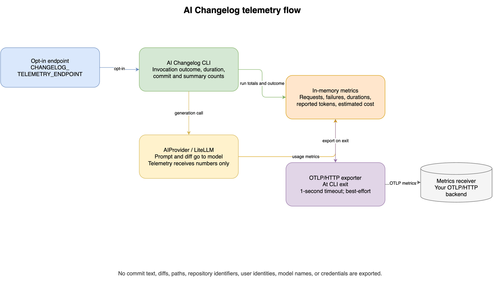

Send content-free usage metrics to an OpenTelemetry Protocol over HTTP
(OTLP/HTTP) metrics receiver.
Telemetry is optional and disabled by default.



[Open the editable draw.io source](../assets/diagrams/telemetry-flow.drawio).

## Configure a receiver

Use a receiver that accepts binary OTLP/HTTP metrics.
The endpoint must be the full metrics URL, not a dashboard or scrape URL.
For example, a local receiver may listen at:

```text
http://127.0.0.1:4318/v1/metrics
```

## Enable export

Set the endpoint in the environment that launches the CLI:

```bash
export CHANGELOG_TELEMETRY_ENDPOINT="http://127.0.0.1:4318/v1/metrics"
uv run ai-changelog /path/to/repository
```

Unset or blank the endpoint to disable telemetry.
The CLI does not append `/v1/metrics` automatically.
Only `http` and `https` URLs without embedded credentials, query strings,
or fragments are accepted.

For a receiver requiring authentication, provide its headers through a
trusted environment or secret manager:

```bash
export OTEL_EXPORTER_OTLP_METRICS_HEADERS="Authorization=Bearer ${TELEMETRY_TOKEN}"
```

For a receiver using a private CA, set
`OTEL_EXPORTER_OTLP_METRICS_CERTIFICATE` to the local certificate path.
Do not commit telemetry credentials.

## Metrics

When telemetry is enabled, each CLI invocation exports
`ai_changelog.invocations` with an `outcome`
of `success` or `error`.
The exporter also sends numeric measurements, including:

- `ai_changelog.commits.*` for discovered, actionable, already-noted, and
  empty-diff commit counts.
- `ai_changelog.summaries.*` for requested, processed, and failed summary
  counts.
- `ai_changelog.completion.*` for logical AI request counts, failures,
  durations, and provider-reported input/output tokens.
- `ai_changelog.cost_estimated` and `ai_changelog.cost_priced_requests` when
  LiteLLM has pricing data for a response.
- `ai_changelog.duration` for total CLI run duration.

Request counts represent logical calls made by the application.
Retries inside the provider are included in request duration, but are not
counted separately.
Token values require provider-reported usage, and estimated costs require
LiteLLM pricing data.
Missing values mean usage or pricing data was unavailable, not that usage or
cost was zero.

## Privacy and delivery

The exporter identifies the service as `ai-changelog`.
Metric attributes contain only the fixed `outcome` category,
and the measurements are numeric.
They do not include commit messages, diffs, file paths, repository paths,
commit hashes, author identities, model names, provider credentials, or
prompt content.
The receiver can still see the network address and any authentication
headers configured for it.

Export is best-effort with a one-second timeout.
Telemetry failures do not change the command result, and metrics are not
queued for later delivery.

## Disable telemetry

Unset the endpoint in the environment that launches the CLI:

```bash
unset CHANGELOG_TELEMETRY_ENDPOINT
```

Remove the export from shell startup configuration too, if present.

See the [CLI reference](../references/cli-reference.md#optional-telemetry)
for the telemetry environment variables.
